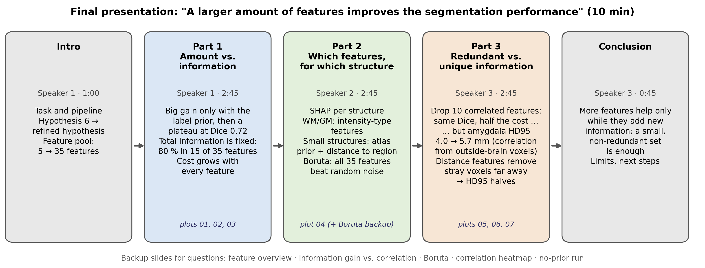

# Final presentation: talking points (10 min, 3 speakers)

Hypothesis 6 (official wording): **"A larger amount of features improves the segmentation performance."**

All plots are in [`plots/`](plots/). Plots `00`–`06` are made by [`make_plots.py`](make_plots.py) from the finished runs in `results/`. The importance plots (`02`, `04`) use **brain voxels only**. [`brain_only_importance.py`](brain_only_importance.py) computes them: it drops the training rows outside the brain mask and retrains the forest with the run's settings and seed. Run both from the repository root, in this order:

```bash
.venv/bin/python "Final Presentation/brain_only_importance.py"
```

```bash
.venv/bin/python "Final Presentation/make_plots.py"
```

Plot `07` and the `B*` backups are copies of figures that already existed in `results/`. `B1`, `B2` and `B4` were still computed on all training rows, including the voxels outside the brain. The first versions of `00`, `02`, `04` and `05` (all training rows) are in [`archive/plots_all_training_rows/`](archive/plots_all_training_rows/).

**Methods note (say it once, on the methods or Part 1 slide):** the pipeline samples training voxels over the whole image, so 31 % of the training rows are background *outside* the brain (T1 = T2 = 0). That makes "inside vs. outside the head" the easiest split and inflates the features that encode it. The segmentation doesn't care (Dice changes < 0.002 without these rows), but importance does. **All importances shown are computed on brain voxels only.**

---

## Flow of the talk




| Block | Speaker | Time | Slides / plots |
|---|---|---|---|
| Intro | 1 | 1:00 | title, pipeline, hypothesis + 3 sub-hypotheses |
| Part 1: amount vs. information | 1 | 2:45 | `01`, `02`, `03` |
| Part 2: which features for which structure | 2 | 2:45 | `04` (Boruta only in one sentence) |
| Part 3: redundant vs. unique information | 3 | 2:45 | `05`, `06`, `07` |
| Conclusion | 3 | 0:45 | one text slide |
| **Total** | | **10:00** | about 9 slides |

Speaker 1 has 3:45 and speaker 3 has 3:30. To balance it, speaker 2 can take the intro.

---

## The refined hypothesis and its three parts

> **Refined hypothesis:** Adding features improves the segmentation only as long as the new features carry information the forest does not already have. Beyond that point performance plateaus while the cost keeps growing. The useful information sits in a small set of features, and which ones matter depends on the structure.

The four draft sub-questions (H1–H4 in `groupwork_requirements.md`) are merged into three parts, one per speaker:

| Part | Refined sub-hypothesis | Came from | Answer |
|---|---|---|---|
| **1 · Amount vs. information** | More features beat the baseline only through features that add new information. The total information the forest can use is fixed, so extra features just share it, and the cost grows with every feature. | H1 | **Confirmed.** Dice plateaus at 0.72 after 12 features; 80 % of the information is in 15 of 35 features; cost ×9 from 5 to 35 features. |
| **2 · Structure dependence** | Different structures rely on different feature families: white/grey matter on intensity-type features, small subcortical structures on location (atlas prior, distance to the typical region). | H2 | **Confirmed** (SHAP per structure). |
| **3 · Redundant vs. unique information** | Highly correlated features can be removed without loss, but correlation is not the same as redundancy. The location features carry unique information that acts **far away from the structure** (stray false positives, HD95), not at the boundary (Dice). | H3 (redundancy) and H4 (where features act) | **Partly confirmed.** 25 features keep the Dice but amygdala HD95 gets worse; distance features halve hippocampus HD95. |

What was **not** done (be honest about it if asked): image perturbations (noise, blur, bias field) from the old H3, padding with noise features from H1, and boundary-vs-interior SHAP maps from H4. Part 3 answers the "where do features act" question in a different way: through the false positives by distance.

---

## Intro (Speaker 1, 1:00)

- Task: segment white matter, grey matter, thalamus, hippocampus and amygdala in T1w/T2w MRI. 20 training and 10 test subjects; a voxel-wise random forest (50 trees, depth 20).
- Our component is feature extraction. The baseline pipeline has **5 features** (3 coordinates, T1 intensity, T1 gradient). We built a pool of **35 features** in 11 families.
- Show the hypothesis, the refined version and the 3 parts (table above). One sentence: *"We don't only ask whether more is better, but **why** some features help and others don't."*
- Metrics: Dice counts overlapping voxels; HD95 measures the 95th-percentile surface distance, so it reacts to stray voxels far away. Every number is the mean over 10 test subjects and 3 seeds.

## Part 1: Amount vs. information (Speaker 1, 2:45)

**Plot `01_dice_hd95_feature_ladder.png`**: Dice and HD95 per structure along the feature ladder 5 → 7 → 12 → 29 → 35.
- Adding T2 (7 features) changes nothing: Dice 0.669 → 0.666.
- **The big jump comes from the label prior (12 features)**, an atlas of where each structure usually is. Hippocampus Dice 0.52 → 0.63; HD95 for hippocampus 11.5 → 5.2 mm, amygdala 11.7 → 6.8 mm, thalamus 10.2 → 3.6 mm.
- From 12 to 35 features the mean Dice stays around **0.72–0.73**. White and grey matter are flat from the start.
- Hippocampus HD95 only improves again at 35 features (8.9 → 4.2 mm), when the distance features come in. That's the topic of Part 3.
- Backup `B3` adds the run *without* any prior (27 features): mean Dice 0.687, hippocampus HD95 15.1 mm. **27 features without location do worse than 12 features with it.** It's not the amount, it's the information.

**Plot `02_infogain_cumulative_extended_plus.png`**: information gain per feature (bars, coloured by family) and its cumulative share (black line). Brain voxels only, seed 0.
- **Which run to show: `extended_plus` (35 features).** It's the full feature pool the hypothesis is about, so it's the only run where the "long tail" is visible: **80 % of the information is in 15 of 35 features, 90 % in 22**.
- The top features are **T1 intensity, T1−T2, and the distances to the typical thalamus and hippocampus regions**: the image contrast plus location.
- The last ~12 features add almost nothing: hemisphere symmetry, gradients, distance to the brain border, small-scale Laplacian of Gaussian, x coordinate. Gradients and symmetry looked important on all rows only because they detect "outside the brain" (see the methods note).
  - Why not the others: in `baseline` (5 features, 80 % in 4) the curve is trivial. `extended_plus_reduced_r09` (25 features, 80 % in 12) is a good *follow-up* number for Part 3 ("after dropping 10 features the information is still concentrated in 12") but not a good first picture.
- How to explain information gain in one sentence: *every split in a tree asks "feature ≤ threshold?" and the information gain is how many bits of uncertainty about the label that question removes; summed over all splits, it shows how much each feature is used.*
- Key message: **the total is about the same for 5 and for 35 features (1.90–1.94 bits per tree, brain voxels).** Every tree has to resolve the same uncertainty about the label (1.99 bits at the root). New features don't add information to resolve; they take a share from the old ones. Backup `B4` shows the same per family for all runs; it's on all rows (≈ 2.04 bits), but the conclusion is the same.
- Caveat if asked: information gain is measured on the training voxels and splits its value among correlated features. The top two (T1 intensity, T1−T2; r = 0.98 inside the brain) carry nearly the same information. Whether a feature is *uniquely* needed is a different question (Part 3).

**Plot `03_compute_cost.png`**: cost and quality per feature set.
- Feature extraction for the 10 test subjects: **9 s (5 features) → 79 s (35 features)**. The feature matrix per test subject grows from 35 MB to 248 MB (1.77 M brain voxels × features × 4 bytes).
- Training the forest itself stays small (1 → 5 s). The cost is in computing and storing the features, and it scales with the number of voxels, so it matters for larger images or datasets.
- Mean Dice stops growing after 12 features, while the cost keeps growing. **More features means more cost, not more performance.**
- Hand-over: *"So which features actually do the work, and for what?"*

## Part 2: Which features, for which structure (Speaker 2, 2:45)

**Plot `04_shap_family_per_structure.png`**: share of the mean |SHAP value| per structure, summed per feature family. `extended_plus`, forest retrained on brain voxels, 2000 balanced brain voxels, seed 0.
- SHAP in one sentence: *for each voxel, how much each feature pushed the predicted probability of this structure up or down. We average the absolute values, so it shows how much the forest relies on a feature for that structure.*
- **White matter: image appearance.** Intensity (20 %), smoothing (18 %) and T1−T2 (11 %) together give **49 %**. The top 3 single features are `T1_intensity`, `T1−T2` and `prior_WM`. WM is the brightest tissue in T1, which is mostly enough.
- **Grey matter: mixed.** ~39 % intensity-type, ~46 % location (prior and distance to region). Top features: `T1_intensity`, `prior_GM`, `T1−T2`. GM is thin and spread across the cortex, so intensity alone isn't enough.
- **Thalamus, hippocampus, amygdala: location.** Label prior + distance to the typical region = **70 %, 68 % and 63 %**. The top 2 for each are its own prior distance and its own prior (e.g. `priordistance_hippocampus`, `prior_hippocampus`). Anatomical reason: these structures are grey matter, so they have almost the same T1/T2 intensity as the tissue around them. The image barely shows where they end; their **position** does.
- Gradients (~1 %) and hemisphere symmetry (< 1 %) hardly matter inside the brain. Their high importance in earlier plots came from telling "inside vs. outside the head" apart.
- That's why the prior gave the big jump in Part 1: it's the only family with information the image features don't have.
- **Boruta in one or two sentences** (backup `B1`): Boruta compares each feature with shuffled copies of itself. All 35 features were confirmed better than noise, so no feature is useless. With this many voxels Boruta is too permissive to tell us which ones we can drop. The Laplacian-of-Gaussian features at small scales and the x coordinate are only just above the random-noise reference. That's the same tail as in plot `02`. (`B1` was computed on all training rows, including the voxels outside the brain. If asked, say the order inside the brain differs, but the "all above noise" message does not change.)
- Hand-over: *"If every feature is better than noise, can we still drop some? That's about redundancy."*

## Part 3: Redundant vs. unique information (Speaker 3, 2:45)

**Plot `05_correlation_drop.png`**: all 35 features vs. 25 features after dropping every feature with |Spearman r| ≥ 0.9 to a more important one.
- How we chose them: cluster the features by correlation and keep the most important (by SHAP) in each group. Examples: `T1_intensity`, `T1_smoothing_s1` and `T1−T2` are almost the same image, so only `T1−T2` is kept.
- **Dice barely changes (every structure ≤ 0.01; mean 0.722 for both).** Extraction time halves (79 s → 38 s, plot `03`). **So highly correlated features can be left out without losing much information.**
- **But amygdala HD95 gets worse: 4.0 → 5.7 mm (p = 0.004).** Among the dropped features were `priordistance_amygdala` (r = 0.91 with `priordistance_hippocampus`, the neighbouring structure) and `priordistance_thalamus` (r = −0.90 with the distance to the brain border).
- **These two correlations were mostly caused by the voxels outside the brain.** Outside, all distance features grow together towards the edge of the image. **Inside the brain they are only r = 0.83 and r = −0.72**, so with brain-only correlations both features would have been kept (footnote of plot `05`). The selection threw away unique location information because of voxels we never segment.
- General point: even a real r = 0.9 leaves a part of the variance that differs, and for a small structure that difference can be exactly the information. The distance to the hippocampus region is *similar* to the distance to the amygdala region on average, but not right at the amygdala, where it matters.
- Supporting number (if there is time): shuffling a whole family on test voxels drops the accuracy by 0.21 for the prior distances, but only by 0.001 for the smoothing features. Smoothing is redundant; the prior distances are unique. This was measured on test voxels, which are all inside the brain, so it isn't affected by the outside rows.
- Careful: 10 features were dropped at once, so the amygdala effect can't be attributed to `priordistance_amygdala` alone with certainty. It's the most likely cause: it's the top SHAP feature for the amygdala. A run with only that feature added back would confirm it.

**Plot `06_fp_distance.png`**: false-positive voxels by distance to the true structure, without (31) vs. with (35) the 4 distance features.
- All false positives: about the same number (hippocampus 90k vs. 96k). So the distance features don't make the boundary better.
- **More than 10 mm away: 2 992 → 5 voxels (hippocampus) and 404 → 4 (amygdala).** Without the distance features, stray voxels far from the structure remain.
- Why that matters for HD95: one stray voxel is "all surface", so a few hundred scattered voxels can be more than 5 % of the predicted surface and set the HD95. **Hippocampus HD95 10.3 → 4.1 mm, amygdala 5.3 → 4.1 mm** (seed 0). Dice counts voxels, so the same stray voxels hardly change it (it even drops slightly, 0.648 → 0.638, because the border gets a bit thicker).
- Why the prior can't remove them: at those far voxels the prior is 0, exactly as it is 1 cm or 6 cm away. The distance feature keeps growing with the distance, so one split separates "just outside" from "far away".

**Plot `07_example_hippocampus_122620.png`**: one test subject, hippocampus prediction projected onto one image. Red = predicted more than 5 mm away. Top (no distance features): blobs above the hippocampus and down in the brainstem. Bottom: everything lies along the true hippocampus.
- Note if asked: keeping only the 2 largest connected components (post-processing) removes the same stray voxels: HD95 10.3 → 4.1 mm without the feature and without the Dice cost.

## Conclusion (Speaker 3, 0:45)

- **Hypothesis 6 as stated is too simple.** More features improved the segmentation only while they added *new* information. The label prior (5 features) did most of the work; 23 more features after it changed the mean Dice by < 0.01.
- The total information the forest uses is fixed; extra features share it, and they cost time and memory.
- What matters depends on the structure: intensity for WM/GM, location for the small subcortical structures.
- Correlated features can be dropped (same Dice, half the time), but **not blindly**: a feature that looks correlated overall can still be the one that matters locally (amygdala HD95). Correlation and importance must be computed on the voxels you actually segment.
- Limits: one dataset with 10 test subjects, 3 seeds, one classifier (random forest). No image perturbations and no noise-padding experiment. The importance plots are on seed 0 only.

---

## Backup: questions we might get

### Why did we choose these features? (one slide, `extended_plus` = 35 features)

| Family | # | What it encodes | Why |
|---|---|---|---|
| coordinates | 3 | x, y, z position in atlas space | baseline features |
| intensity | 2 | T1, T2 value | tissue contrast; T2 adds CSF/GM contrast |
| gradient | 2 | edge strength (T1, T2) | tissue boundaries; baseline had T1 only |
| smoothing | 6 | Gaussian σ = 1, 2, 4 mm (T1, T2) | less noisy intensity, includes the neighbourhood |
| Laplacian of Gaussian | 6 | blobs and edges at σ = 1, 2, 4 mm | structure at different scales |
| local statistics | 4 | mean and std in 5×5×5 voxels | uniform tissue vs. boundary / partial volume |
| T1 − T2 | 1 | both contrasts in one number | a simple combined contrast |
| label prior | 5 | probability of each structure at this position (atlas from the training subjects) | small structures have little intensity contrast |
| distance to brain border | 1 | signed distance to the brain surface (mm) | cortex is near the surface, WM/thalamus deep inside |
| distance to typical region | 3 | signed distance to the region where the prior is > 0.5 (hippocampus, amygdala, thalamus) | tells "just outside" from "far away" |
| hemisphere symmetry | 2 | difference to the mirror voxel (T1, T2) | the brain is nearly symmetric |

Built in two steps: the classical image features from the lecture (intensity, gradients, smoothing/LoG at several scales, local statistics), then the location features after the first results showed that the small structures are the problem.

### What is the difference between information gain and correlation?

- **Correlation is between two features** (feature ↔ feature). It doesn't look at the labels. A high |r| means two features carry nearly the same information: **redundancy**.
- **Information gain is between a feature and the label** (feature ↔ label), measured inside the trees: how much uncertainty about the label the splits on that feature remove. High information gain means the forest **uses** the feature: **relevance**.
- They answer different questions and can disagree. `T1_intensity` and `T1−T2` both have high information gain *and* correlate strongly (r = 0.98): both are relevant, but one is enough. When one is removed, the forest moves its splits to the other one and nothing is lost (`reduced_r09` drops `T1_intensity`, and the share of T1−T2 rises from 10 % to 16 %; brain voxels).
- Both depend on *which* voxels you compute them on. Over the whole image, the outside-brain background made some features look correlated (prior distances, r ≥ 0.9) and others look important (gradients, distance to the brain border). Inside the brain neither holds.
- Neither one tells you whether a feature is **uniquely** needed. That's what the grouped permutation importance on test voxels shows: shuffling the prior distances costs 0.21 accuracy, shuffling smoothing 0.001.

### Further backup plots

- `B1_boruta_extended_plus.png`: Boruta, every feature vs. the random-noise reference (dashed line). *All training rows.*
- `B2_correlation_heatmap_extended_plus.png`: correlation of all feature pairs; dark blocks = redundant groups. *All training rows; inside the brain the prior-distance, gradient and symmetry blocks are weaker.*
- `B3_dice_hd95_all_runs_incl_no_prior.png`: all runs including "no prior" (27 features, worse than 12 features with the prior). Test results, not affected.
- `B4_infogain_by_family_all_runs.png`: information gain split by family for every run; total is always ~2.04 bits. *All training rows; on brain voxels the total is 1.90–1.94 bits for every run, so the same conclusion.*
- Why is the information gain ranking (plot `02`, top = T1 intensity) different from SHAP for the small structures (top = their own prior distance)? Information gain is weighted by the number of voxels at each split, and WM, GM and background are most of the voxels. SHAP was computed per structure on a balanced sample.
- Why are the first splits in the original forest about background? With all training rows, one threshold (T1 = 0 or distance to the brain border < 0) separates 31 % of the rows as pure background, and no other split comes close. On brain voxels only, the first splits are on T1 intensity, T1−T2 and T2 intensity.

### Key numbers on one card

| | baseline (5) | + T2 (7) | + prior (12) | reduced (25) | no prior (27) | extended (29) | no distance (31) | extended+ (35) |
|---|---|---|---|---|---|---|---|---|
| mean Dice | 0.669 | 0.666 | 0.722 | 0.722 | 0.687 | 0.729 | 0.730 | 0.722 |
| mean HD95 (mm) | 7.6 | 7.9 | 3.9 | 3.5 | 10.1 | 4.4 | 4.3 | 3.1 |
| hippocampus HD95 (mm) | 11.5 | 12.5 | 5.2 | 4.3 | 15.1 | 8.9 | 8.9 | 4.2 |
| amygdala HD95 (mm) | 11.7 | 12.0 | 6.8 | 5.7 | 13.6 | 5.3 | 5.0 | 4.0 |
| test feature extraction (s) | 9 | 9 | 11 | 38 | 92 | 44 | 72 | 79 |

Means over 10 test subjects and 3 seeds, no post-processing. The plot-06/07 numbers (hippocampus HD95 10.3 → 4.1 mm) are seed 0 only, which is why they differ slightly from this table (8.9 → 4.2 mm).
